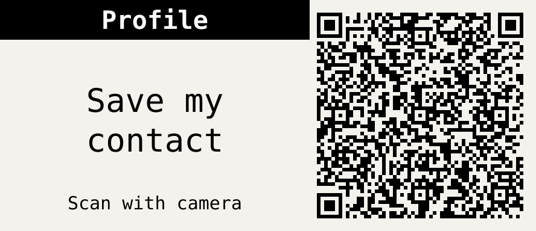

<div align="center">

# 🦡 Section Badge

**A config-driven conference badge for the [Pimoroni Badger 2040](https://shop.pimoroni.com/products/badger-2040).**

Three buttons pick a section; Up and Down page through it. Pages can be QR codes, photo badges or logos, all defined in one JSON file, on a screen that holds its image with no power.


[**Features**](#features) · [**Quick start**](#quick-start) · [**Configuration**](#configuration) · [**Using the badge**](#using-the-badge) · [**Troubleshooting**](#troubleshooting)

<br />



<sub>Mock-up with placeholder text only.</sub>

</div>

---

## About

This turns a Badger 2040 into a tidy, battery-free **section badge**. Each of the three front buttons opens a *section*; **Up** and **Down** flip through the pages inside it and wrap around. A page can be:

- a **full-screen logo**,
- a **photo badge** with your picture, name, title and website, or
- a **QR code**: a link, or a **vCard** that adds you to someone's contacts.

Everything on the badge comes from one `badge.json` file. Your real details and logos live in a private place and are copied to the badge by a single command, so this public repo holds no personal data, only code, tooling and clearly labelled placeholders.

<p align="right"><a href="#-section-badge">⬆ back to top</a></p>

## Features

- Sections, pages, text and QR data are all declared in `badge.json`. Re-badge yourself for a new event without touching code.
- E-ink keeps the last image with no power. Press a button and the badge wakes, draws the page, and sleeps again.
- Text uses the built-in bitmap fonts at whole sizes only, so it stays sharp on e-ink.
- QR codes are drawn as large as the screen allows, with whole-pixel modules and an optional quiet zone, so phones can read them.
- One QR holds a vCard: name, title, company, email, phone, website and LinkedIn, straight into a phone's contacts.
- Real data stays in a private folder; the repo and tooling refuse to ship or commit it.
- A local validator (no badge needed) checks every page and sizes every QR before you deploy.
- 1306 tests run on a PC against fake hardware modules.

### The badge at a glance

Buttons **A / B / C** open sections `a / b / c`. The titles below are only examples; name your sections anything you like.

| Button | Example section | Pages (Up / Down to flip, wraps around) |
|:---:|---|---|
| **A** | Profile | photo badge → contact QR (vCard) → website QR |
| **B** | Company | logo → role badge → website QR |
| **C** | Event | logo → schedule QR |

There's also a **Project** app (section `p`) on the launcher, with a QR to this repo, an about page and a QR to the hardware. It pages with Up/Down like any other section, and A/B/C inside it jump to your three main sections.

> The launcher order (which apps appear, and on which page) is set in [`device/launcher.py`](device/launcher.py). Apps that aren't on the badge are skipped.

<p align="right"><a href="#-section-badge">⬆ back to top</a></p>

## Hardware

| You need | Notes |
|---|---|
| **Pimoroni Badger 2040** | the RP2040 model, 296×128 1-bit e-ink |
| **USB cable** | to flash and deploy |
| **Badger OS v0.0.5** | MicroPython 1.23.0 |
| **A PC with Python 3.11+** | runs the tooling and tests |

<p align="right"><a href="#-section-badge">⬆ back to top</a></p>

## Quick start

Five steps: flash, install, configure, convert, deploy.

### 1 · Flash Badger OS v0.0.5

1. Download the `v0.0.5` `.uf2` from the [Pimoroni Badger 2040 releases](https://github.com/pimoroni/badger2040/releases).
2. Hold **BOOT/USR** on the back, plug in USB (or press **RESET** while holding BOOT). A drive called `RPI-RP2` appears.
3. Drag the `.uf2` onto that drive. The badge restarts into the launcher.

### 2 · Install the tooling

```bash
git clone https://github.com/henniefrancis/badger2040.git
cd badger2040
python -m venv .venv
.venv\Scripts\activate            # Windows   •   macOS/Linux: source .venv/bin/activate
pip install -r requirements.txt
```

`requirements.txt` pins exact versions: `mpremote` copies files to the badge, Pillow converts images, pytest runs the tests.

### 3 · Make your private config

Keep your real config outside this repo, in a private repo or a private folder.

```bash
mkdir my-badge                               # a private location of your choice
copy config\badge.example.json my-badge\badge.json
```

Edit `badge.json` (full schema in [Configuration](#configuration)). The shape:

```json
{
  "sections": {
    "a": {
      "title": "Profile",
      "pages": [
        {"type": "badge", "header": "Hello, I'm", "name": "Your Name", "title": "Your title",
         "website": "example.com", "image": "/images/me.png", "image_w": 104, "image_y": 0},
        {"type": "qr", "title": "Save my contact", "text": "Scan to add me", "vcard": {
          "name": "Your Name", "title": "Your title", "company": "Your company",
          "email": "you@example.com", "phone": "+00 000 000 0000",
          "url": "https://example.com", "linkedin": "https://linkedin.com/in/your-handle"}},
        {"type": "qr", "title": "My website", "text": "Visit my site", "url": "https://example.com"}
      ]
    },
    "b": {
      "title": "Company",
      "pages": [
        {"type": "image", "image": "/images/company.png"},
        {"type": "badge", "header": "Senior Engineer", "name": "Your Name", "title": "Platform Team",
         "website": "example.com", "image": "/images/me.png", "image_w": 104, "image_y": 0},
        {"type": "qr", "title": "Our website", "text": "Visit us", "url": "https://example.com"}
      ]
    },
    "c": {
      "title": "Event",
      "pages": [
        {"type": "image", "image": "/images/event.png"},
        {"type": "qr", "title": "Schedule", "text": "Scan for the agenda", "url": "https://example.com/schedule"}
      ]
    },
    "p": {
      "title": "Project",
      "pages": [
        {"type": "qr", "title": "Build your own", "text": "Fork this badge", "url": "https://github.com/henniefrancis/badger2040"},
        {"type": "text", "header": "About this badge", "lines": ["Pimoroni Badger 2040", "Powered by MicroPython", "", "pimoroni.com/badger2040"]}
      ]
    }
  }
}
```

Validate it any time, no badge required:

```bash
python tools\validate_config.py my-badge
```

### 4 · Convert your logos and photo

Use **your own** logos and trademarks, or ones you're licensed to use.

```bash
python tools\convert_image.py company-logo.png my-badge\images\company.png --kind logo
python tools\convert_image.py company-logo.png my-badge\icons\icon-company.png --kind icon
python tools\convert_image.py my-photo.jpg   my-badge\images\me.png       --kind photo
```

### 5 · Deploy

Take a [backup](#restore-from-a-backup) first. Then, with the badge plugged in:

```bash
python tools\deploy.py --config my-badge --port COM3
```

Add `--dry-run` to preview the file list without touching the badge.

<p align="right"><a href="#-section-badge">⬆ back to top</a></p>

## Configuration

Everything you can change lives in `badge.json`. The sections below hold the full reference.

<details>
<summary><b>Sections</b></summary>

<br />

- Sections `a`, `b`, `c` are the **A / B / C** buttons; `p` is the **Project** app on the launcher. All four are required.
- Each section has a `title` (max 20 characters) and **1 to 8 pages**.
- Inside any section, **Up/Down** page and wrap; **A/B/C** jump to sections `a/b/c`.
- You may add **extra sections** too. See *Add your own sections* below.

</details>

<details>
<summary><b>Page types</b></summary>

<br />

| Type | What it shows |
|---|---|
| `badge` | a photo at the right edge, a black `header` bar across the top, then `name`, and optional `title` and `website` over the photo |
| `image` | a full-screen 1-bit PNG |
| `qr` | a QR for a `url` **or** a `vcard`; optional `title` (bar, falls back to the section title, max 40 chars) and `text` body (max 60 chars) |
| `text` | a `header` title in a black bar, then up to 6 `lines` in the small font (15 px apart; an empty string is a spacer; over-wide lines are cut with `..`) |

**Title bars** look the same on every page type: a 16 px black bar with white small-font text, centred. Bar text is never shrunk, so the validator fails any title or header that won't fit. QR body text uses the largest whole size (2, then 1) at which every word fits. Text must contain no control characters, and is ASCII only (the fonts have no accented characters). All text uses the built-in bitmap font at whole sizes only, with no vector fonts.

</details>

<details>
<summary><b>Badge pages</b> (photo + text)</summary>

<br />

```json
{"type": "badge", "header": "<bar text>", "name": "<name>", "title": "<optional>",
 "website": "<optional>", "image": "/images/me.png", "image_w": 104, "image_y": 0}
```

The layout is fixed, with a white background and no border or divider:

1. The **photo** is drawn at the right edge (`x = 296 − image_w`, `y = image_y`). Make the PNG exactly `image_w` px wide (the badge can't scale down; `--kind photo` makes 104×128). `image_w` defaults to 104, `image_y` to 0.
2. A **full-width black bar**, 16 px high, over the top of the photo, with the `header` centred in white.
3. **Black text**, left-aligned at x 2, over the photo: `name` at size 3 (y 24), `title` at size 2 (y 92), `website` at size 2 (y 110).

The validator **fails** a `header` or `name` that won't fit (name at size 3 fits ~20 characters) and **warns** when `title` or `website` is wider than the screen. On the device, over-wide text steps down a whole size and is then cut with `..`.

</details>

<details>
<summary><b>QR codes</b></summary>

<br />

- A QR page takes either a `url` **or** a `vcard`.
- The code is drawn **as tall as the screen allows**, with whole-pixel modules (**at least 2 px**, so phones scan it), **right-aligned**. The title bar runs across the top of the *left* area and stops 4 px before the code; the body `text` is centred below it.
- **`qr_border`** (optional, top level) sets a quiet-zone border in modules per side:
  - `0` *(default)*: no padding; the code is as large as its density allows (`128 // modules` px per module).
  - `1` to `4`: adds that border (may shrink the code). ISO/IEC 18004 recommends 4.
  - `"auto"`: the largest border (0 to 4) that does **not** shrink the code.
- The validator prints each code's modules, border, px-per-module and pixel size, and **fails** any QR that would drop below 2 px per module. A full 7-field vCard is roughly 57 to 61 modules and caps at 2 px (114 px).

</details>

<details>
<summary><b>vCard</b></summary>

<br />

vCard 3.0 with `name`, `title`, `company`, `email`, `phone`, `url` (website) and `linkedin`. Special characters are escaped for you. **Leave a field empty to skip it.** One scan adds you to a phone's contacts.

</details>

<details>
<summary><b>Images</b></summary>

<br />

Image paths in `badge.json` are paths **on the badge** and must be `/images/<name>.png`; the file is taken from `images/<name>.png` in your private folder. Convert with `tools/convert_image.py`:

| `--kind` | Size | Used for |
|---|---|---|
| `logo` | 296×128, centred on white | full-screen `image` pages |
| `icon` | 52×52 | launcher icons |
| `photo` | 104×128 | **recommended** for badge photos: crop, contrast, sharpen, brighten, Floyd-Steinberg dithering |
| `badge` | 104×128 | same slot, plain fit + threshold (no tuning) |

All output is 1-bit PNG. The converter refuses an all-white result (e.g. a fully transparent input) unless you pass `--allow-blank`, and stops with a one-line error on corrupt or oversized images.

Files in your private `images/` and `icons/` folders replace the repo's placeholders of the same name. Validation and deploy **fail** if a logo or launcher icon you reference would fall back to a repo placeholder. For a first trial with placeholders, pass `--allow-placeholder-images` (it prints a warning).

</details>

<details>
<summary><b>Add your own sections</b></summary>

<br />

Besides `a`, `b`, `c` and `p`, `badge.json` may hold extra sections. A key must match `^[a-z][a-z0-9_]{1,15}$` (for example `work`); the example config ships one called `work`. An extra section is validated like the others, pages and wraps around, and A/B/C inside it jump to `a/b/c`.

Each section is opened by a small wrapper app of the same name. To add one:

1. Create `device/badge/<key>.py` with `import badgekit` and `badgekit.run_section("<key>")` (copy `profile.py` and change the key).
2. Add the app name to `APPS` in [`tools/deploy.py`](tools/deploy.py) and to `SECTION_APPS` in [`device/launcher.py`](device/launcher.py) (and to the page-order lists there to place it on the launcher).
3. Optionally add `icon-<key>.png` (52×52) to your private `icons/` folder.

</details>

<p align="right"><a href="#-section-badge">⬆ back to top</a></p>

## Using the badge

| Button | In a section |
|:---:|---|
| **A / B / C** | open that section, page 1 |
| **Up** | previous page (wraps from the first to the last) |
| **Down** | next page (wraps from the last to the first) |
| **A + C together** | back to the launcher |

The badge remembers the section and page it was on. The e-ink screen holds its image with no power, so the badge is usually off: press a button on battery and it wakes, shows the page you pressed for, and powers down again. Over USB it stays awake and keeps listening.

If the config is missing or wrong, the badge shows an **error page naming the problem** instead of crashing. Fix the config, deploy again, and press any button.

<p align="right"><a href="#-section-badge">⬆ back to top</a></p>

## Privacy

> [!IMPORTANT]
> Everything in `badge.json` (the vCard included) is stored as **plain text** on the badge, and anyone who plugs it into USB can read it. Put only business-card-level details on it, and **wipe the badge** (re-flash Badger OS, or delete `/badge/config/badge.json` and `/state`) before you lend, sell or discard it.

The workflow is built to keep real data out of this public repo: your config and images live in a private folder, `.gitignore` and the test suite block personal data from being committed, and the placeholders here are clearly labelled.

<p align="right"><a href="#-section-badge">⬆ back to top</a></p>

## Troubleshooting

<details>
<summary><b>A phone won't scan a QR code</b></summary>

<br />

Codes are full size with no quiet zone by default. Set `"qr_border": 2` (or `"auto"`) in `badge.json` to add a quiet zone, validate, and deploy again. If validation says the code gets too small, shorten the vCard (fewer or shorter fields).

</details>

<details>
<summary><b>An error page on the badge</b></summary>

<br />

It names the problem (missing or invalid config, missing image, QR too dense). Fix the config, deploy, and press any button.

</details>

<details>
<summary><b>Validation says a logo or icon would use a placeholder</b></summary>

<br />

Put your own file in `images/` or `icons/` in your private folder (see [Images](#configuration)).

</details>

<p align="right"><a href="#-section-badge">⬆ back to top</a></p>

## Development

```bash
python -m pytest -q tests
```

Tests run on a PC against fake `badger2040`, `badger_os`, `pngdec` and `qrcode` modules in `tests/fakes/`. They cover config validation, vCard escaping, QR sizing, paging and wrap-around, state restore, error pages, the validator, the image converter and the deploy planner, and they fail if a real config is ever tracked or the example looks like it contains a real email or phone number.

<details>
<summary><b>Project layout</b></summary>

<br />

```text
device/            mirrors the badge filesystem
  launcher.py      Badger OS launcher (owner-defined order)
  lib/badgekit.py  shared drawing, config, paging and state code
  badge/   one small wrapper app per launcher entry
  images/          placeholder logos and the sample photo
config/            badge.example.json (placeholders only)
tools/             deploy.py, validate_config.py, convert_image.py
tests/             pytest suite and fakes
docs/              build plan
```

</details>

### Restore from a backup

Before you change a badge, copy its files to your PC (Thonny's file browser works, or `python -m mpremote connect COM3 fs cp -r :images backup/files/` per folder, and `fs cp :launcher.py backup/files/` for single files).

- Put single files back with `python -m mpremote cp backup\files\launcher.py :launcher.py`.
- For a bit-for-bit restore (firmware **and** files), dump the whole 2 MB flash before you start and keep the `.uf2`. To restore, hold BOOT/USR, plug in USB, and drag that `.uf2` onto the `RPI-RP2` drive.

<p align="right"><a href="#-section-badge">⬆ back to top</a></p>

## Known limitations

- vCard lines aren't folded at 75 octets (RFC 2425 §5.8.1). Phone scanners accept this; strict parsers may not.
- Button presses made while the screen is refreshing are dropped.

## Contributing

Issues and pull requests are welcome. Please run `python -m pytest -q tests` before opening a PR; the whole suite should pass.

## License

MIT. See [LICENSE](LICENSE). Parts are based on Pimoroni's MIT-licensed Badger 2040 code; see [THIRD_PARTY_NOTICES.md](THIRD_PARTY_NOTICES.md).

Any logos and trademarks you add are yours or their owners'. This project does not license them, and ships only clearly labelled placeholders.

## Acknowledgments

- [Pimoroni](https://shop.pimoroni.com/products/badger-2040) for the Badger 2040 hardware and Badger OS.
- [MicroPython](https://micropython.org/) for the runtime on the board.
